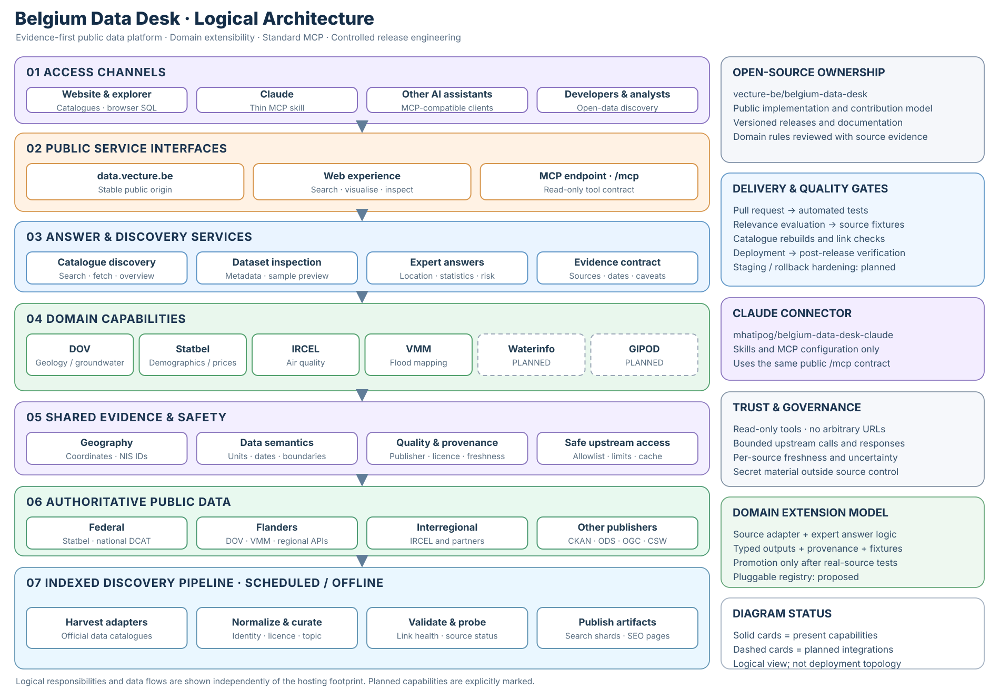

# Architecture

[Edit the drawing in draw.io](./architecture.drawio).

**Maintainer note.** Keep Belgium Data Desk a modular monolith: one public source of truth, one Cloudflare deployment and one stable MCP endpoint shared by Claude and other clients. Each new domain must be independently testable, reuse bounded upstream access and shared identifiers, and produce evidence-backed answers with provenance. Preserve existing tool contracts; ship verified capabilities, not tool sprawl.

This is a **target architecture**, not a deployment inventory. DOV, Statbel, air quality and flood risk are implemented; Waterinfo, GIPOD and further domain isolation are planned. Cloudflare uses static assets, edge caching, rate limits and Analytics Engine—no KV or Durable Objects today. Secrets belong outside Git. Retire the old `web-operations` deployment path only after cutover verification.
