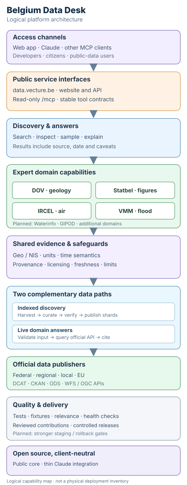

# Architecture

[Detailed architecture](./architecture.svg) · [Editable draw.io source](./architecture.drawio)

**Maintainer principle.** Keep one authoritative open-source product and a stable public MCP contract. Separate indexed discovery from live, source-backed answers. Every domain must preserve bounded upstream access, identifiers, units, freshness and provenance, with reproducible tests before release. Claude stays a thin client; capabilities belong in the shared platform.

**Status.** DOV, Statbel, IRCEL, VMM and catalogue indexing are implemented. Live answer tools are a pluggable registry: one definition per file in `tools/` (contract in `lib/tool-contract.mjs`, recorded-answer tests, scaffold; see [adding a tool](./adding-a-tool.md)). Waterinfo, GIPOD and stronger release gates are future extensions. This is a **logical architecture**, not an inventory of deployed infrastructure.
